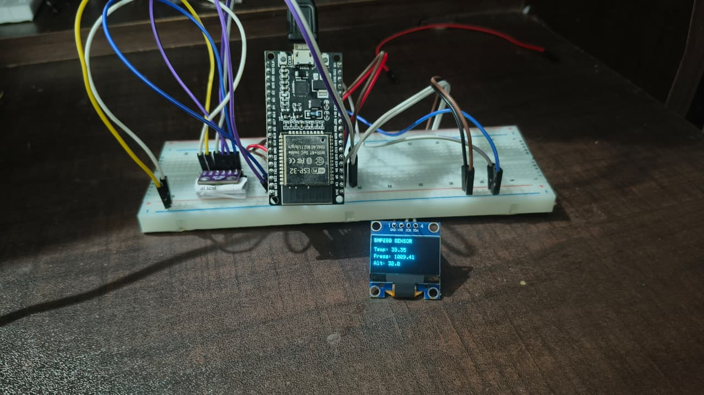

# ESP32 BMP280 Environmental Sensor Monitor

An embedded systems project built using an ESP32, BMP280 environmental sensor, and SSD1306 OLED display. The system measures temperature and atmospheric pressure, estimates altitude, and displays the readings in real time.

## Project Demo

### Hardware Setup

### Video Demonstration

[Watch the project demonstration](sensor-monitor.mp4)

## Features

* Measures temperature using the BMP280 sensor.
* Measures atmospheric pressure in hPa.
* Estimates altitude using a reference sea-level pressure.
* Displays sensor readings on an SSD1306 OLED.
* Outputs readings through the Serial Monitor.
* Handles sensor initialization and invalid readings.

## Hardware Used

* ESP32 development board
* BMP280 barometric pressure and temperature sensor
* SSD1306 128 × 64 OLED display
* Breadboard and jumper wires

## Wiring

The OLED and BMP280 share the ESP32's I²C bus.

| ESP32 Pin | OLED    | BMP280 |
| --------- | ------- | ------ |
| GPIO 21   | SDA     | SDA    |
| GPIO 22   | SCL     | SCL    |
| 3V3       | VCC/VDD | VCC    |
| GND       | GND     | GND    |

**BMP280 configuration:** I²C address `0x77` (with the board configured accordingly). The OLED uses address `0x3C`.

## Software and Libraries

* Arduino framework
* Adafruit BMP280 Library
* Adafruit GFX Library
* Adafruit SSD1306 Library
* Wire library

## How It Works

1. The ESP32 initializes the I²C bus and OLED display.
2. It attempts to initialize the BMP280 sensor.
3. At regular intervals, it reads temperature and pressure and calculates an approximate altitude.
4. Valid readings are printed to the Serial Monitor and displayed on the OLED.
5. The program handles initialization failures and invalid sensor readings.

## What I Learned

* Interfacing I²C sensors with an ESP32.
* Reading and validating sensor data.
* Using structures and pointers to organize sensor readings.
* Updating a display at regular intervals using `millis()`.
* Handling sensor initialization and error conditions.

## Future Improvements

* Add a graphical pressure and temperature history.
* Improve sensor disconnection detection and recovery.
* Add Wi-Fi monitoring through a web dashboard.

## Author

**Nidhin** — First-year Electronics and Communication Engineering student at FISAT.

[GitHub Profile](https://github.com/nidhin-ez)
